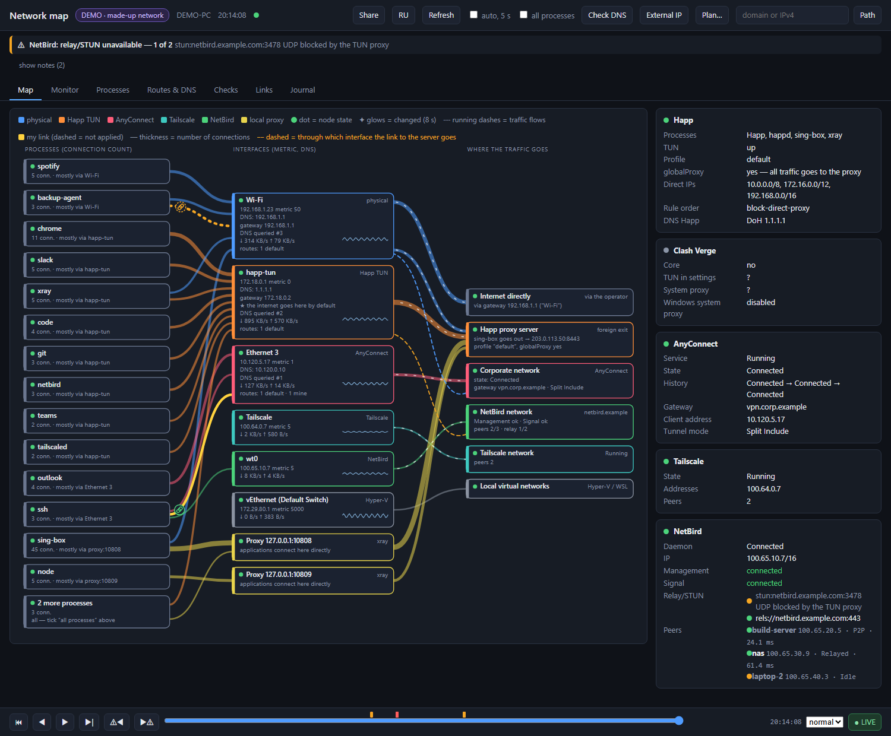
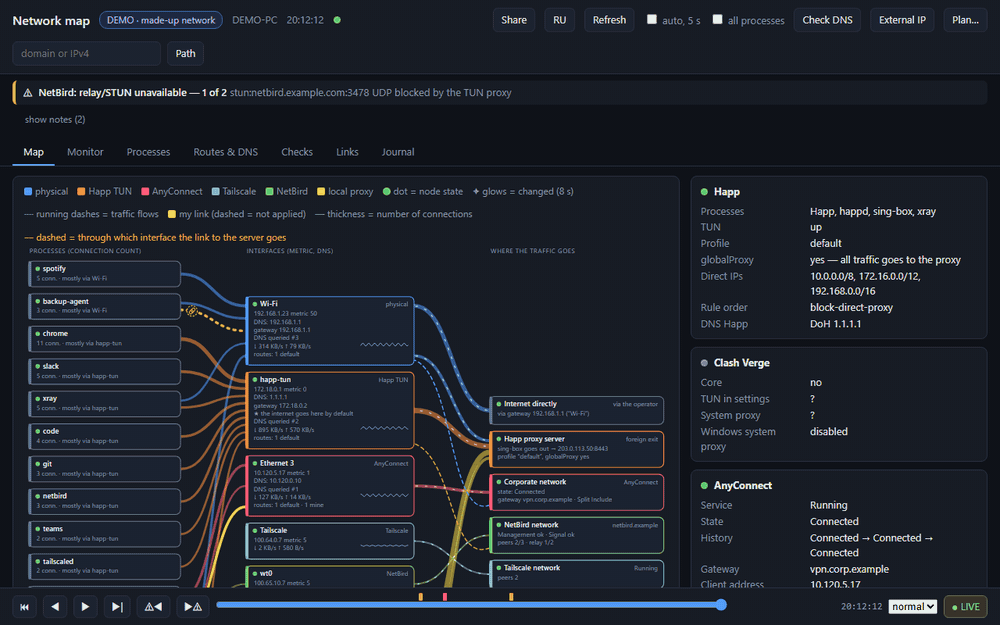
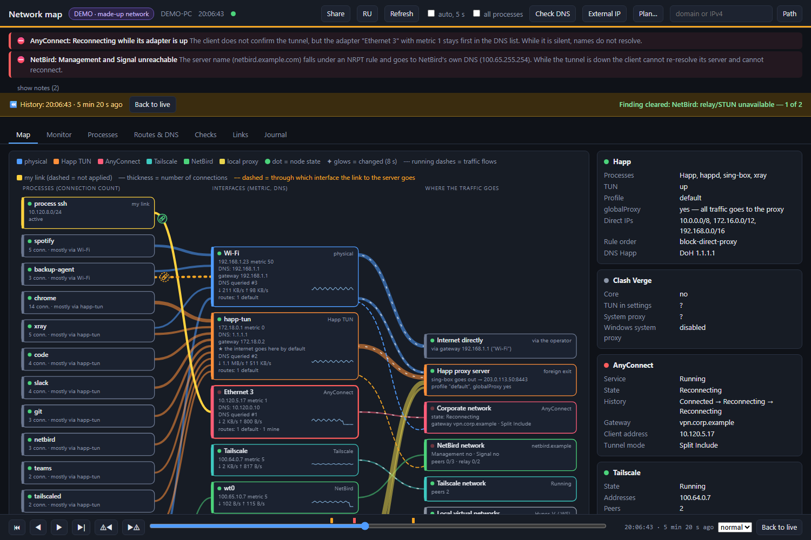

# netmap — карта сети Windows

[English](README.md) · **Русский**

**▶ [Попробовать демо прямо в браузере](https://andrewmoryakov.github.io/netmap/)** — без установки, вымышленные данные и готовый инцидент для перемотки.

Локальная страница только для чтения: показывает, **какая программа через какой сетевой интерфейс (включая VPN и прокси-туннели) куда отправляет трафик**, и помогает понять, почему несколько VPN на одной машине мешают друг другу. Главная фишка — **машина времени**: тяните ползунок, и вся карта перематывается на момент, когда отвалился капризный VPN. Так можно *увидеть* сбой, который не воспроизводится, пока на него смотришь.



*На скриншотах вымышленные демонстрационные данные.*

## Машина времени

Страница хранит каждый полученный снимок. Шкала внизу перематывает весь интерфейс (карту, боковую панель, все вкладки) на любой момент. Предупреждения и ошибки отмечены на шкале, `⚠◀` / `▶⚠` прыгают между инцидентами, стрелки двигают на шаг, пробел запускает воспроизведение, End возвращает в «сейчас».





В демо Cisco AnyConnect начинает переподключаться, адаптер с метрикой 1 остаётся первым в списке DNS и замолкает, имена перестают разрешаться, а NetBird теряет сервер управления, потому что его собственный домен попадает под NRPT-правило. Всё это видно кадр за кадром на одной карте.

## Поделиться и не засветить лишнее

Кнопка **«Поделиться»** создаёт файл целиком в странице, ничего никуда не отправляется:

- **PNG карты** ровно в том виде, как вы её видите, или
- **всю запись одним HTML-файлом**, который открывается в любом браузере без установки и без сервера, с рабочим ползунком времени: повтор, который можно приложить к баг-репорту или опубликовать в статье.

По умолчанию всё **анонимизируется**: IP-адреса, домены, имена компьютеров, пиров, адаптеров и необычных процессов заменяются согласованными псевдонимами (одно и то же значение всегда получает один и тот же псевдоним; хосты одной /24 остаются в одной /24; частные диапазоны остаются частными). Диалог показывает, что именно заменено, и видно это только вам. Проверьте результат перед публикацией: в произвольных текстах может остаться то, что программа не распознала.

## Возможности

- **Карта «процесс → интерфейс → назначение»**: адаптеры, маршруты, DNS, локальные прокси, соединения по процессам (толщина линии — число соединений).
- **Знает про** Happ, Clash Verge, Cisco AnyConnect, Tailscale, NetBird (со своими сборщиками данных); WARP, GlobalProtect, FortiClient, ZeroTier, OpenVPN, WireGuard, WSL, Hyper-V показывает как универсальные виды. Список и цвета — в `netmap.config.json`.
- **Состояние узлов**: цветная точка в заголовке (норма / внимание / проблема / отключён), замечания сверху (например, «два TUN одновременно», «DNS перехвачен», «домен сервера попадает под NRPT-правило»).
- **Живой трафик**: скорость ↓/↑ по адаптерам, мини-график, бегущие штрихи по линиям «интерфейс → назначение».
- **Подсветка изменений**: узел или линия мигает 8 секунд, если что-то изменилось; подсказка говорит, что именно.
- **Монитор и журнал**: фоновые пробы DNS/ping, журнал событий (`events.jsonl`).
- **Проверки по кнопке**: опрос каждого DNS-сервера, внешний IP (напрямую и через локальные прокси), «Путь» до домена/IP.
- **«План…»**: составляет *план*, как направить адрес, подсеть или программу через другой интерфейс (перетащите узел на интерфейс). Выдаёт скрипты применения и отката, **сам ничего не применяет**.
- **«Связи»**: реестр ваших намерений (`netmap.links.json`), статусы «не применена / действует / отмечена вручную / расходится», классификация маршрутов.
- **Все процессы**: по умолчанию на карте 14 самых активных процессов, остальные свёрнуты в один узел; флажок «все процессы» (или кнопка в панели свёрнутого узла) показывает каждый.
- **Русский и английский**: язык берётся из браузера, кнопка `RU` / `EN` переключает, `?lang=ru` задаёт явно. Сообщения сервера следуют за страницей (`-Lang ru|en` — язык консоли по умолчанию).

## Принципы безопасности

- **Только чтение.** Карта ничего не меняет в системе: ни маршруты, ни `hosts`, ни настройки VPN. Все изменения — скриптами из «Плана», которые вы копируете и запускаете сами.
- Слушает **только `127.0.0.1`** (порт 47900, если занят — до 47909), наружу ничего не отправляет. Исключение — кнопки проверок (запрос на `cloudflare.com` для внешнего IP и DNS-пробы), только по вашему нажатию.
- Защита локального API: проверка заголовка `Host`, обязательный заголовок `X-NetMap`, запись — только `POST` с `Content-Type: application/json`.
- Вводимые адреса и подсети валидируются; подсети шире `/8` отклоняются.
- Записанная история живёт только в открытой странице (перезагрузка начинает новую), пока вы её не экспортируете.

## Требования

- Windows 10/11.
- **PowerShell 7** (`pwsh`). При запуске из Windows PowerShell 5.1 скрипт сам перезапустится в `pwsh`, если он установлен.
- Современный браузер.
- Права администратора не нужны для карты; они понадобятся только для выполнения скриптов из «Плана» (маршруты).

## Запуск

```
netmap.cmd
```

или

```
pwsh -NoProfile -ExecutionPolicy Bypass -File netmap.ps1 [-Port 47900] [-NoBrowser] [-Lang ru]
```

Откроется `http://127.0.0.1:47900/`. Остановить — закрыть окно консоли (Ctrl+C). Первый сбор данных занимает до 20 секунд, дальше страница обновляется каждые 5 секунд.

**Нет Windows под рукой?** Откройте `index.html` прямо с диска (или [демо](https://andrewmoryakov.github.io/netmap/)): без сервера страница переходит в демо-режим с вымышленной сетью. `?demo=1` включает его принудительно, `?demo=0` отключает.

## Настройка

Всё, что карта «узнаёт», описано в `netmap.config.json` (правится без изменения кода, после правки перезапустите карту): `adapterKinds`, `processes`, `paths`, `localProxyPorts`, `hotspotGatewayRx`, `skipDnsServersRx`, `probes`. При старте конфиг проверяется; ошибка сообщается понятным текстом.

## Файлы

| Файл | Назначение |
|---|---|
| `netmap.ps1` | сервер (HTTP на loopback), сбор данных, планы и реестр связей |
| `netmap-monitor.ps1` | фоновый монитор (DNS, ping, события) |
| `index.html` | вся страница: карта, вкладки, «План…», «Связи», машина времени, «Поделиться», демо |
| `netmap.config.json` | настройки |
| `netmap.cmd` | запуск двойным щелчком |

Создаются при работе рядом со скриптами и не попадают в git: `netmap.log`, `events.jsonl`, `netmap.links.json`.

## Ограничения

- Живые данные — только Windows + PowerShell 7 (демо и записи работают везде); на других машинах проверена мало.
- Для программ вне списка (без собственного сборщика) карта покажет адаптер, маршруты и узел назначения, но не данные самой программы.
- Скорость считается по адаптерам, а не по процессам (средствами Windows без ETW это не получить).
- Привязка соединения к интерфейсу идёт по локальному адресу сокета; UDP/QUIC-цепочки видны хуже TCP.
- Применение маршрутов кнопкой с автооткатом пока не реализовано — только копирование скриптов.
- Машина времени держит в памяти около 80 минут снимков с шагом 5 секунд.

## Лицензия

MIT, см. `LICENSE`.
